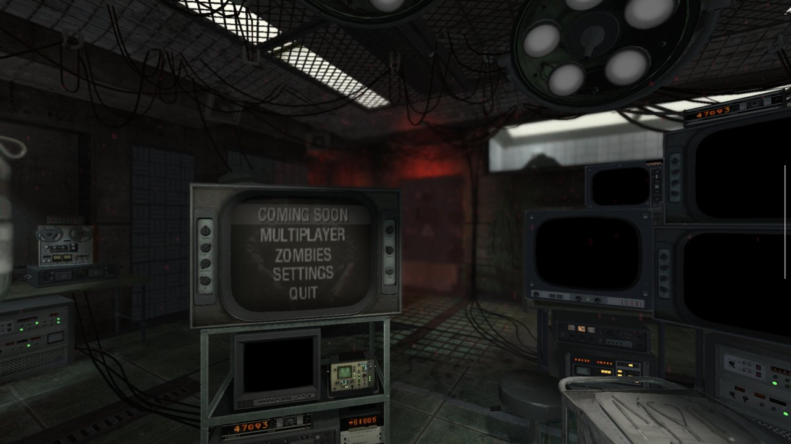
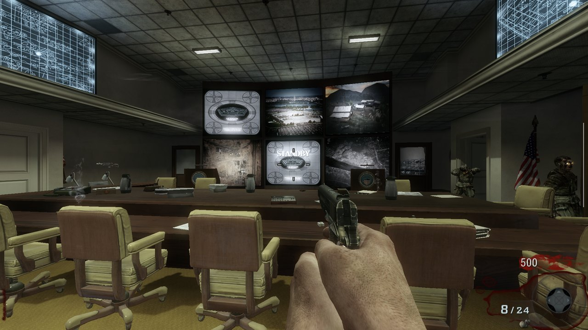
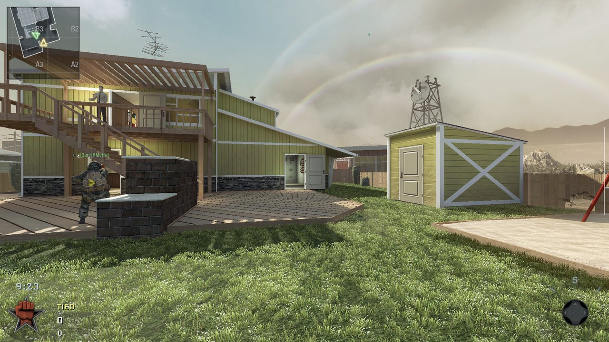
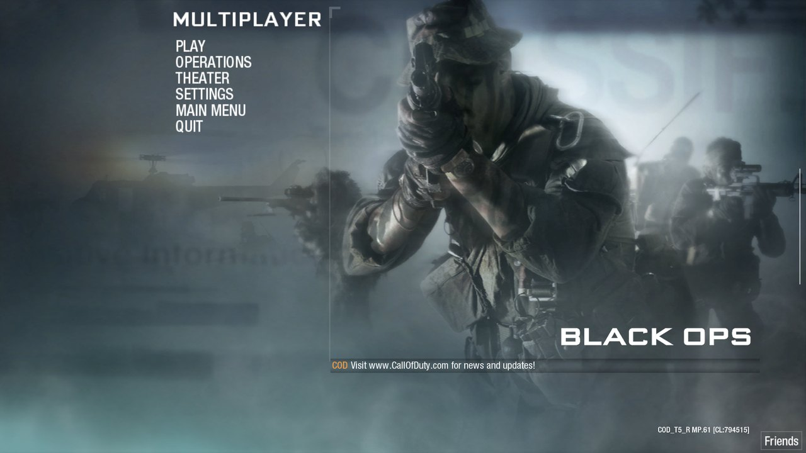

# BO1 Decompiled Android

*Call of Duty: Black Ops* (2010) running natively on Android: **Zombies and Multiplayer** on arm64 phones and
handhelds, built from the decompiled PC engine. Vulkan renderer (DXVK), controller and touch controls, the original
menus, offline Combat Training and Private Match, co-op over the local network or by address. 150 to 250 FPS at
1080p on a Snapdragon 8 Elite.

**[Download the APK (latest release)](https://github.com/Zephelinn/bo1-decompiled-android/releases/latest)** ·
**[Install guide](docs/INSTALL-ANDROID.md)** · [Requirements](#devices-and-requirements) · [Benchmarks](#benchmarks)

**You need your own copy of *Call of Duty: Black Ops* (PC, Steam).** No game files are in this repository or in the
app: you copy your Steam install to the device once. Not affiliated with Activision, Microsoft or Xbox
([NOTICE.md](NOTICE.md)).

Screenshots from this build on an AYN Odin 3 (1920x1080, Vulkan):

| | |
| --- | --- |
|  |  |
| Zombies: the original main menu | Zombies: Five |
|  |  |
| Multiplayer: Nuketown, a bot match | Multiplayer: the original menus, offline |

## Get started

1. Download `bo1-port-<version>.apk` from the **[latest release](https://github.com/Zephelinn/bo1-decompiled-android/releases/latest)**.
2. Follow **[docs/INSTALL-ANDROID.md](docs/INSTALL-ANDROID.md)**: install the app, copy your Steam game folder to the
   device, play.

This repository is a fork of [spacemandev-git/bo1-zombies-decompiled](https://github.com/spacemandev-git/bo1-zombies-decompiled),
the decompiled engine with Zombies on Windows and in the browser; its Windows and web versions are still here
(see Documentation).

## What works

| | status |
| --- | --- |
| Zombies | All maps of your install (the DLC maps if you own them). Solo, and co-op by address or on the local network, up to 4 players |
| Multiplayer | Bot matches, Combat Training (rank, unlocks, Create a Class, saved on the device), Private Match, the original menus |
| Not available | Campaign; online Server Browser, Ranked Match, Wager Match (they need Activision's online service); joining by code |
| Controls | Controllers (built-in, Bluetooth, USB) as on a console; on-screen touch controls with a layout editor |
| Mods | The repository's script mods (`mods/`), chosen in Settings > EXTRAS > MOD |
| Sound | All game sound, including the xWMA effects (FFmpeg decoder). No reverb or EQ effects |
| Video | Cinematics (Bink) are skipped |

## Devices and requirements

Only one device has been tested: the **AYN Odin 3** (Snapdragon 8 Elite, Adreno 830, Android 15). Everything in
the "minimum" column is an estimate from what the game needs, not a tested device.

| | minimum (estimated) | recommended |
| --- | --- | --- |
| Android | 8.0 (API 26), 64-bit ARM (arm64-v8a) | 13 or newer |
| Chip | Snapdragon 865-class (8 CPU cores) | Snapdragon 8 Gen 2 or newer (tested: 8 Elite) |
| GPU | Vulkan 1.3 with `VK_EXT_robustness2` (Adreno 6xx/7xx on a current driver) | Adreno 740 or newer (tested: Adreno 830) |
| RAM | 6 GB | 8 GB or more (a map uses about 1.5 GB of game memory, plus the GPU driver's) |
| Storage | 12 GB free (the game folder is about 11 GB) | the same, on internal storage |
| Game | *Call of Duty: Black Ops* (PC, Steam); the Multiplayer files for Multiplayer | the latest Steam version, with the DLC for its Zombies maps |

Mali (Exynos, Tensor, MediaTek) and Xclipse GPUs have not been tried. x86 Android devices and 32-bit-only phones are
not supported.

## Renderers

Settings > Graphics > RENDERER (RESTART). Both translate the game's Direct3D 9 to the device's graphics API.

| | Vulkan (default) | OpenGL ES 3 |
| --- | --- | --- |
| How | DXVK 2.6.1 (D3D9 on Vulkan) with the project's patches | the project's own D3D9 layer with MojoShader (shaders to GLSL ES) |
| Needs | Vulkan 1.3 and `VK_EXT_robustness2` | OpenGL ES 3.0 |
| Picture | complete | complete (the same scene as Vulkan) |
| Speed on the Odin 3 | 150 to 250 FPS at 1920x1080 (benchmarks below) | 54 to 63 FPS at 1920x1080 (benchmarks below) |
| Anti-aliasing (`r_aaSamples` 2 / 4) | yes (4x: about 60 FPS in Kino der Toten) | not tested |
| Shader compiling | effects in the background (a new effect can be missing for a frame the first time); surfaces wait for theirs (a few short hitches on a map's first visit, once) | at the draw: a hitch the first time a shader combination appears in a session |
| Use it | always, where the device has Vulkan 1.3 | where Vulkan is not available; the app falls back to it by itself then |

## Benchmarks

AYN Odin 3, Vulkan, 1920x1080, no anti-aliasing, vsync off, no frame limit (`com_maxfps 0`), the game's own FPS
counter (Settings > EXTRAS > FPS COUNTER). The display shows at most 120 frames a second; the numbers above that are
what the device renders.

| scene | FPS | 5 % low | 1 % low |
| --- | --- | --- | --- |
| Zombies: Kino der Toten, in play at the start | 179 | 166 | 154 |
| Zombies: Kino der Toten, other places in the map | 180 to 230 | | |
| Zombies: main menu (the room with the TV) | 213 to 225 | | |
| Multiplayer: Nuketown with 5 bots, team menu over the map | 152 | 143 | 137 |
| Multiplayer: Combat Training match, in play | 207 | | |
| Multiplayer: Private Match, in play | 253 | | |
| Multiplayer menus (drawn once a display refresh) | 142 | | |
| Kino der Toten, 4x anti-aliasing | 60 | | |
| Kino der Toten, 1280x720, vsync on at 120 Hz (first build) | 120 | 108 | 94 |
| OpenGL ES: Five, in play at the start | 63 | 61 | 61 |
| OpenGL ES: Kino der Toten, in play | 54 | | |

The GPU was at 99 % in the Vulkan Zombies runs; the CPU at about 30 %. On OpenGL ES the GPU was at about 25 %: that renderer is
limited by the driver's work on the CPU.

## Documentation

- `docs/INSTALL-ANDROID.md` - installing and playing on Android.
- `docs/android-port.md` - how the Android and Linux versions work, building them, their dvars, what is verified.
- `docs/building-windows.md` - the Windows build and the proprietary SDK files it needs (not in this repository).
- `CLAUDE.md` - how the engine and the repo are organized (also the index for AI-assisted work).
- Mods: `mods/<name>/README.md` (`sandbox`, `horde`, `nightmare`, `zinfo` + `noperks`, `coop`), `mods/mapkit/MAPKIT.md`;
  `tools\mod-launcher.hta` starts them.
- Online co-op (up to 4 players with the original characters, 5-8 with duplicates): `docs/multiplayer.md`,
  `tools\coop.ps1` (`coop-host.bat`, `coop-join.bat`).
- Controllers: `docs/controllers.md`.
- Browser version (spacemandev.games/bo1): `web/README.md`, `docs/web-port.md`, `docs/web-engine-interface.md`.

## Building the Android app

On a Linux machine (Debian/Ubuntu, x86-64), from the repository root. The scripts expect the work folder `/bo1` with
this repository at `/bo1/src` (the maintainers use a Docker container with the folder mounted there):

```
tools/native/android-setup.sh    # once: JDK, Android SDK, NDK, SDL2
tools/native/build-dxvk.sh       # DXVK 2.6.1 with the project's patches
tools/native/build-ffmpeg.sh     # FFmpeg's WMA decoder (LGPL)
tools/native/build-p32.sh        # the 32-bit-pointer source tree + Linux x86-64 build
tools/native/build-android.sh    # libbo1.so, libmain.so, SDL2 for Android
tools/native/build-apk.sh        # the APK (RELEASE_KEYSTORE=... for a release-signed one)
```

`docs/android-port.md` has the details. No proprietary SDK is needed for the Android, Linux or browser builds.

## Legal

- Not affiliated with or endorsed by Activision, Microsoft or Xbox. *Call of Duty* and *Black Ops* are trademarks of
  Activision Publishing, Inc. See **[NOTICE.md](NOTICE.md)**, our notice to them. It explains that this
  non-commercial project was made with the help of an AI model, for experimenting with new ways to play an older
  game, and how to reach us.
- The engine source is decompiled from the original game. It is not offered under an open-source licence. Code the
  project added is the maintainers' own; third-party components and their licences are listed in
  [THIRD_PARTY_NOTICES.md](THIRD_PARTY_NOTICES.md).
- The game's own files are never in this repository or the app: `setup.ps1` copies them from your install on
  Windows, the Android app reads the copy you put on the device, and the browser version reads them from your
  computer.
