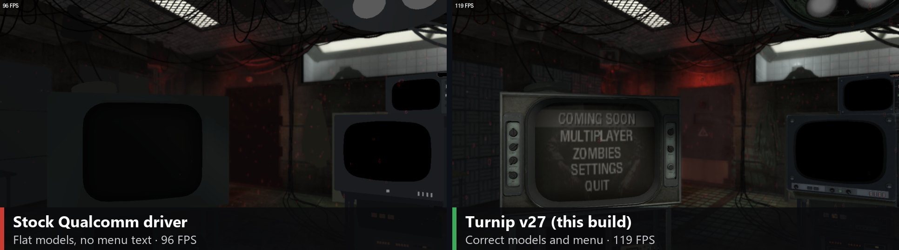
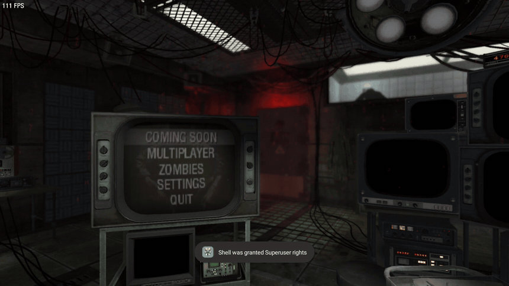
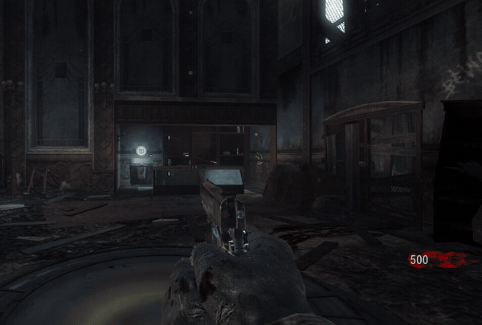
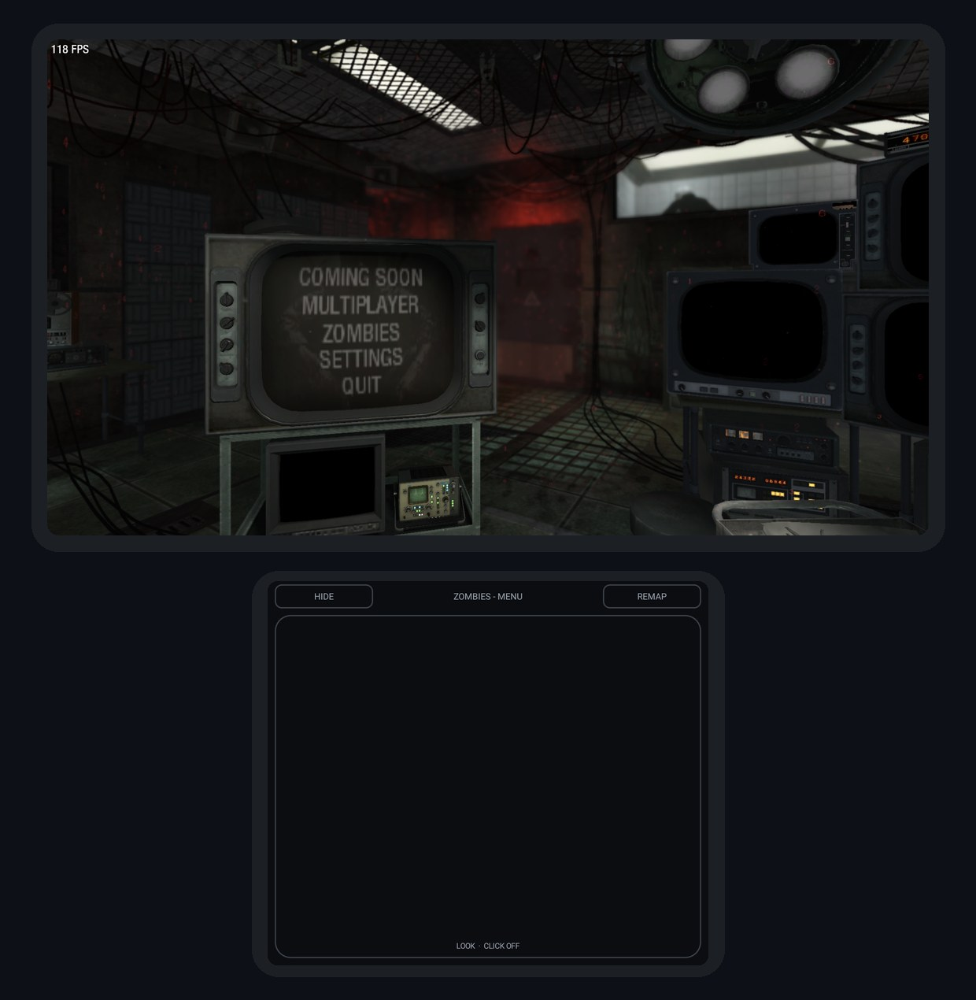
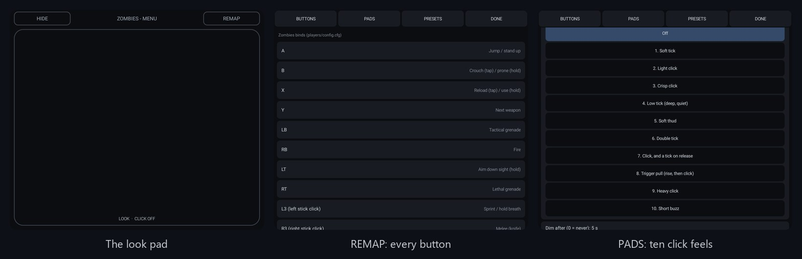

<div align="center">



# BO1 Port · Turnip

**Created by [Sevy](https://github.com/SevyW)**

*Call of Duty: Black Ops* (2010) Zombies running natively on Android, on **your choice of Vulkan driver**. This is a fork of [Zephelinn's Android port](https://github.com/Zephelinn/BO1-Ascension-ARM64) that can load **Mesa Turnip** through libadrenotools, the way Eden, ARMSX2 and Vita3K do. On Adreno 7xx devices with an older Qualcomm driver, it turns a broken picture into a correct one, and it's faster too.


-a41e22?logo=vulkan&logoColor=white)


-3fa35b)

</div>

> [!NOTE]
> **Created by [Sevy](https://github.com/SevyW), vibe-coded with Claude.**
> The Turnip support in this fork was written by [Claude](https://claude.ai) (Anthropic's AI) through Claude Code, in a back-and-forth with me. I set the goals and made the decisions; Claude wrote, built and debugged the code, and tested it on my AYN Thor over adb.
>
> The game engine itself is the work of the projects this one is forked from (see [Credits](#-credits)). **You need your own copy of *Call of Duty: Black Ops* for PC (Steam).** No game files are in this repository or in the app.

<div align="center">

| 🎨 **Correct** | ⚡ **119 FPS** | 🔌 **1 file** | 📦 **Side by side** |
|:---:|:---:|:---:|:---:|
| models and TV menus,<br>where the stock driver draws them flat | in the Zombies menu on a Thor<br>(stock driver: 96) | `driver.txt` picks the driver;<br>no driver, no change | installs next to the<br>original app |

</div>

## 🎬 See it work

<table>
  <tr>
    <td width="58%"></td>
    <td width="42%"></td>
  </tr>
  <tr>
    <td><sub><b>The main menu, live</b> on the Thor at 1920x1080, Turnip v27, about 118 FPS: the TV's menu is drawn into a texture on the TV model, as on PC.</sub></td>
    <td><sub><b>Kino der Toten</b>, aiming with the bottom-screen look pad.</sub></td>
  </tr>
</table>

<sub>Recorded on the device with Android's screen recorder; the FPS counter is cropped out of the gameplay clip because recording slows the GPU.</sub>

## 🆕 New in 0.5-turnip

**📺 The TV menu survives a graphics change.** Changing the refresh rate, sync, anti-aliasing or video mode restarts the video, and until now the TV in the main menu room went blank until you reopened the app. It keeps its menu now.

**🎚️ One place for the frame rate.** Settings > Graphics decides it: SCREEN REFRESH RATE with SYNC EVERY FRAME, or no limit with sync off. Switching SYNC EVERY FRAME takes effect when the video restarts, without restarting the app. The EXTRAS row FRAME RATE LIMIT is gone, and the cap it left in your settings is cleared once.

## 🆕 New in 0.4-turnip

**🕹️ Second-screen controls.** On a dual-screen handheld like the AYN Thor, the bottom screen becomes a trackpad for aiming, and pressing your thumb flat on it fires. A remapping screen on the same display rebinds every button while you play. More below and in [docs/second-screen.md](docs/second-screen.md).

## 🆕 New in 0.3-turnip

**🔌 Choose your Vulkan driver.** Put a Turnip driver package in the app's `driver/` folder, write its name in `driver.txt`, and the game runs on it. Leave `driver.txt` out and it runs on the system driver, exactly as before. Every start writes one line to the log saying which driver it's using and why.

**🛠️ Fixes flat, untextured models on Adreno 740.** With Qualcomm's driver 0.676.53 (the AYN Thor's), Vulkan drew every model as one flat colour and the TV menus were missing. OpenGL ES drew it right, but at about 19 FPS. On Turnip, Vulkan draws it right at full speed.

**📦 A separate app.** The package is `org.bo1port.zombies.turnip`, labelled **BO1 Port Turnip**, so it installs next to the original and never replaces it.

## 📊 Tested on an AYN Thor

Snapdragon 8 Gen 2 (Adreno 740), Android 13, Vulkan renderer, the Zombies main menu (the room with the TV):

| Vulkan driver | Loaded | Models and TV menu | FPS |
| --- | :---: | --- | ---: |
| System: Qualcomm 0.676.53 | ✅ | ❌ flat grey, no menu text | 96 |
| [MrPurple](https://github.com/MrPurple666/purple-turnip) T30 (Mesa 26.3.0) | ✅ | ✅ correct | 104 |
| [MrPurple](https://github.com/MrPurple666/purple-turnip) T28 (Mesa 26.2.0) | ✅ | ✅ correct | 86 |
| **[StevenMXZ](https://github.com/StevenMXZ/Adreno-Tools-Drivers) v27.0.0-R1 (Mesa 27.0.0)** | ✅ | ✅ **correct** | **119** |

Uncapped, at 1280x720. Kino der Toten has been played on v27, and v27 also holds a 60 FPS cap at 1920x1080.


## 📦 Download

**[Download the latest release](https://github.com/SevyW/BO1-Ascension-ARM64/releases/latest)**: `bo1-port-turnip-v0.5.apk`, with its SHA-256 in the release notes.

| | |
| --- | --- |
| Android | 8.0 or newer, 64-bit ARM |
| GPU | Adreno 6xx/7xx for Turnip. Other GPUs run on their system driver, as in the original app |
| Game | *Call of Duty: Black Ops* for PC (Steam): the whole game folder, about 9.4 GB for Zombies |
| Storage | about 10 GB free (one copy of the game folder) |

## 🧭 Set it up

1. **Install** `bo1-port-turnip-v0.4.apk` and open it once, so Android creates its folder.
2. **Copy your game.** Your Steam *Black Ops* folder goes to `Android/data/org.bo1port.zombies.turnip/files/game/`. If you already have the original app with its game files, copy them across:
   ```
   adb shell cp -r /sdcard/Android/data/org.bo1port.zombies/files/game/. \
                   /sdcard/Android/data/org.bo1port.zombies.turnip/files/game/
   ```
   [Zephelinn's install guide](docs/INSTALL-ANDROID.md) covers the game folder in detail. The package name is the only difference.
3. **Add a driver.** Unzip an AdrenoTools driver package (a `.zip` with a `meta.json` and a `.so`) into its own folder, then name that folder in `driver.txt`:
   ```
   adb shell mkdir -p /sdcard/Android/data/org.bo1port.zombies.turnip/files/driver/v27
   adb push meta.json libvulkan_freedreno.so /sdcard/Android/data/org.bo1port.zombies.turnip/files/driver/v27/
   adb shell "echo v27 > /sdcard/Android/data/org.bo1port.zombies.turnip/files/driver.txt"
   ```
4. **Play.** Check which driver it picked:
   ```
   adb shell grep "vulkan driver" /sdcard/Android/data/org.bo1port.zombies.turnip/files/bo1.log
   ```
   - On the custom driver: `vulkan driver: custom "v27" from driver/v27/libvulkan_freedreno.so ... Turnip Mesa 27.0.0-devel`
   - On the system driver: `vulkan driver: system (<the reason>)`

> [!WARNING]
> **Don't uninstall the app to update it.** Android deletes `Android/data/<app>/` on uninstall, and that's where your 9.4 GB game folder lives. Install updates over the top.

### ⚙️ Handy settings

Everything that sets the frame rate is on one page: **Settings > Graphics**.

| Graphics setting | What it does |
| --- | --- |
| **SCREEN REFRESH RATE** | How often the screen refreshes: 120 Hz or 60 Hz on the AYN Thor. |
| **SYNC EVERY FRAME: YES** | The frame rate follows the refresh rate: 120 Hz gives 120 FPS, 60 Hz gives 60 FPS (saves battery). |
| **SYNC EVERY FRAME: NO** | No cap: the game runs as fast as it can. |
| **VIDEO MODE** | Render resolution. The port starts at 720p; 1920x1080 holds about 120 FPS on a Thor with Turnip v27. |
| **ANTI-ALIASING** | Off is best on a handheld: 4x costs about a third of the frame rate at 1080p (78 instead of 118 FPS on a Thor). |
| **FPS COUNTER** | The on-screen frame counter. |

Nothing else caps the frame rate: the old EXTRAS row FRAME RATE LIMIT is gone, and 0.5 clears the cap it left in your settings once. (`com_maxfps` still works from the console, for anyone who wants a cap of their own.)

The settings are saved in `home/players/config.cfg` (Zombies) and `config_mp.cfg` (Multiplayer): `r_displayRefresh`, `r_vsync`, `r_mode`, `r_aaSamples` and `com_maxfps`.

## 🕹️ Second-screen controls

On a device with a second display (the AYN Thor's bottom screen), the game puts a trackpad there by itself. On a phone with one screen nothing changes.

<p align="center">
  
  <br>
  <sub>Both screens of the Thor: the game on top, the look pad underneath.</sub>
</p>

| | |
| --- | --- |
| 👆 **Look** | slide a finger: the view turns like a mouse, with adjustable sensitivity and acceleration |
| 🔫 **Fire** | press your thumb flat on the glass. The press is read from the contact size, since the screen has no pressure sensor. Double tap or press-and-hold also work, or turn the click off so the pad only aims |
| 📳 **Feel** | ten vibrations to choose from for the press, or none |
| 🎛️ **REMAP** | rebind every button of the built-in pad and the trackpad press. Changes apply at once, with presets per mode and a reset to the console layout |
| 🙈 **HIDE** | shrinks it to a small button so you can use the launcher. Settings > EXTRAS > SECOND-SCREEN CONTROLS turns it off |

The game keeps the controller's focus while you touch the bottom screen. Details and settings: [docs/second-screen.md](docs/second-screen.md).

<p align="center">
  
  <br>
  <sub>On the bottom screen: the look pad, <b>REMAP</b> (every button and its action) and <b>PADS</b> (the ten click feels).</sub>
</p>

## ⚙️ How it works

- **Loading the driver.** On every start, `bo1_driver.c` reads `driver.txt`. It copies the driver to internal storage, because external storage can't run code, and opens it with **libadrenotools**. Then it checks that a Vulkan device comes up. Any failure falls back to the system driver.
- **Rendering.** DXVK, which turns the game's Direct3D 9 into Vulkan, gets that driver's `vkGetInstanceProcAddr` instead of loading the system `libvulkan.so`. It makes its window surface through the same loader. The swapchain stays the Android loader's, so presenting works as before.
- **The game itself** (`libbo1.so`) is unchanged. Without `driver.txt`, nothing behaves differently.

The full list of changes and the build log are in [STATUS.md](STATUS.md).

## 🎮 What works

Everything [the original port](https://github.com/Zephelinn/BO1-Ascension-ARM64) does. This fork has been device-tested in Zombies only.

| | |
| --- | --- |
| Zombies | All maps of your install. Solo, and co-op by address or on the local network |
| Multiplayer | Bot matches, Combat Training, Private Match (not yet tried on Turnip) |
| Not available | Campaign; online matchmaking (it needs Activision's servers) |
| Controls | Built-in, Bluetooth and USB controllers; on-screen touch controls with a layout editor; second-screen trackpad and remapping on dual-screen devices; pad binds in `config.cfg` ([docs/controllers.md](docs/controllers.md)) |
| Renderers | Vulkan (DXVK, recommended) and OpenGL ES 3 (the fallback): Settings > Graphics > RENDERER |
| Mods | Settings > EXTRAS > MOD picks a mod from the device's `game/mods/` folder. Community mods work as before; the script mods (horde, nightmare, coop, ...) are in [Zephelinn's repo](https://github.com/Zephelinn/BO1-Ascension-ARM64/tree/main/mods) |

## 🗺️ What's next

- 📂 **Pick the driver in the app** instead of with a text file.
- 🎯 **Tune the trackpad**: settle the look speed and the press depth on more devices.

## 🚀 Building

The same recipe as the original port, on Linux x86-64 with the repo at `/bo1/src`:

```
bash tools/native/android-setup.sh
bash tools/native/build-ffmpeg.sh arm64-v8a
bash tools/native/build-p32.sh
bash tools/native/build-android.sh
bash tools/native/build-dxvk.sh arm64-v8a
bash tools/native/build-adrenotools.sh    # new: libadrenotools and its hook libraries
bash tools/native/build-apk.sh
```

[STATUS.md](STATUS.md) has the exact steps used for this release, and [docs/android-port.md](docs/android-port.md) has the details.

## 📚 Documentation

- [docs/INSTALL-ANDROID.md](docs/INSTALL-ANDROID.md): installing and playing on Android
- [docs/android-port.md](docs/android-port.md): how the Android version works, its settings, building it
- [docs/controllers.md](docs/controllers.md): controllers, default layout, binds
- [docs/second-screen.md](docs/second-screen.md): the trackpad and remapping screen on a dual-screen device's second display
- [docs/multiplayer.md](docs/multiplayer.md): co-op
- [CLAUDE.md](CLAUDE.md): how the engine and the repo are organized
- Windows and browser versions: in the upstream repositories (see [Credits](#-credits)); this fork builds for Android only

## 🐞 Something not working?

[Open an issue](https://github.com/SevyW/BO1-Ascension-ARM64/issues/new/choose) and include:
- your device and Android version
- the `vulkan driver:` line from `bo1.log`
- which driver package you used
- what you see

A screenshot helps a lot.

## 🙏 Credits

- **[Zephelinn](https://github.com/Zephelinn/BO1-Ascension-ARM64)**: the Android port. Everything that makes the game run on Android is theirs.
- **[spacemandev-git](https://github.com/spacemandev-git/bo1-zombies-decompiled)**: the decompiled engine with Zombies on Windows and in the browser, which the Android port builds on.
- **[MisaDev4](https://github.com/MisaDev4/bo1-zombies-decompiled)**: the original Black Ops 1 Zombies decompilation.
- **[bylaws/libadrenotools](https://github.com/bylaws/libadrenotools)**: loading custom drivers on Android.
- **Mesa Turnip** and the people who build it for Android: [MrPurple](https://github.com/MrPurple666/purple-turnip) and [StevenMXZ](https://github.com/StevenMXZ/Adreno-Tools-Drivers).
- **[DXVK](https://github.com/doitsujin/dxvk)**, **SDL2**, **FFmpeg**: see [THIRD_PARTY_NOTICES.md](THIRD_PARTY_NOTICES.md).

## ⚖️ Legal

- Not affiliated with or endorsed by Activision, Microsoft or Xbox. *Call of Duty* and *Black Ops* are trademarks of Activision Publishing, Inc. See **[NOTICE.md](NOTICE.md)**.
- The engine source is decompiled from the original game and is **not offered under an open-source licence**. Third-party components and their licences are listed in [THIRD_PARTY_NOTICES.md](THIRD_PARTY_NOTICES.md).
- The game's own files are never in this repository or the app. You copy your own install to your device.
- Non-commercial. There's no donation link on purpose.
